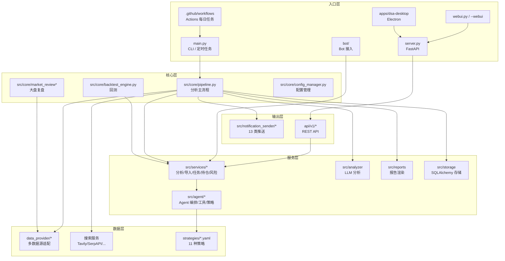

# 📈 股票智能分析系统（Daily Stock Analysis · 工程详解版）

<p align="center">
  
  
  
  
  
  
</p>

> **本仓库是 [ZhuLinsen/daily_stock_analysis](https://github.com/ZhuLinsen/daily_stock_analysis) 的 fork**（保留上游 MIT 许可与署名），当前没有修改业务代码；本 README 是面向工程阅读的**详细版**：补充了模块分层、数据流、配置体系、API、Agent 架构、测试与部署细节，方便二次开发与本地排障。上游产品向 README 请以原仓库为准。

一个基于大模型的 **A 股 / 港股 / 美股自选股智能分析系统**：每日自动聚合行情、技术指标、资金流、新闻与公告，调用 LLM 生成「决策仪表盘」，并推送到企业微信 / 飞书 / Telegram / Discord / Slack / 邮件等渠道。支持 GitHub Actions 零成本定时运行、本地 / Docker 部署、Web 工作台、Electron 桌面端与 Bot 接入。

```text
自选股列表
  ↓
① 数据聚合（多数据源 fallback：efinance → akshare → tushare/pytdx → baostock → yfinance → longbridge → tickflow）
  ↓
② 技术分析（趋势 / 均线 / 缠论等）+ 新闻搜索（Tavily / SerpAPI / Bocha / Brave / MiniMax / SearXNG）
  ↓
③ LLM 分析（LiteLLM 统一入口：Gemini / Claude / OpenAI / DeepSeek / 通义 / Ollama…）
  ↓
④ 报告生成（决策仪表盘：结论 / 评分 / 趋势 / 买卖点 / 风险 / 催化 / 检查清单）
  ↓
⑤ 多渠道推送 + 入库（历史报告 / Web 工作台 / Bot 查询）
```

---

## 目录

- [1. fork 说明与上游关系](#1-fork-说明与上游关系)
- [2. 功能总览](#2-功能总览)
- [3. 系统架构](#3-系统架构)
- [4. 代码分层与模块地图](#4-代码分层与模块地图)
- [5. 快速开始](#5-快速开始)
- [6. 配置体系](#6-配置体系)
- [7. 运行模式与 CLI](#7-运行模式与-cli)
- [8. 数据源与降级策略](#8-数据源与降级策略)
- [9. Agent 策略问股](#9-agent-策略问股)
- [10. Web 工作台与桌面端](#10-web-工作台与桌面端)
- [11. API 概览](#11-api-概览)
- [12. Bot 与 IM 接入](#12-bot-与-im-接入)
- [13. 通知渠道](#13-通知渠道)
- [14. 调度、交易日历与自动化](#14-调度交易日历与自动化)
- [15. 测试与 CI](#15-测试与-ci)
- [16. 部署方式](#16-部署方式)
- [17. 目录结构](#17-目录结构)
- [18. 二次开发注意事项](#18-二次开发注意事项)
- [19. 已知限制](#19-已知限制)
- [20. 许可与免责声明](#20-许可与免责声明)

---

## 1. fork 说明与上游关系

| 项 | 说明 |
| --- | --- |
| 本仓库 | `jinhaozheng-kk/daily_stock_analysis`（fork） |
| 上游 | [ZhuLinsen/daily_stock_analysis](https://github.com/ZhuLinsen/daily_stock_analysis) |
| 状态 | fork=True，代码与上游同步（HEAD 为上游提交 `60d8211`），**本 fork 目前只补充了这份 README** |
| 许可 | 上游 [MIT License](LICENSE)，© 2026 ZhuLinsen；fork 保留原许可与署名 |
| 同步方式 | GitHub fork 同步上游 → `Sync fork`，或本地 `git remote add upstream ... && git fetch upstream && git merge upstream/main` |
| 注意 | 桌面端 `electron-builder` 的发布目标（`publish.owner`）仍是上游 `ZhuLinsen`，fork 若要发布自己的桌面版需改 `apps/dsa-desktop/package.json` |

上游项目定位是"个人自选股每日分析 + 推送"，本 README 不改变其产品定位，只补充工程实现细节；具体产品说明、赞助信息与联系方式以[上游仓库](https://github.com/ZhuLinsen/daily_stock_analysis)为准。

## 2. 功能总览

| 能力 | 覆盖内容 |
| --- | --- |
| **AI 决策报告** | 核心结论、评分、趋势判断、买卖点位、风险警报、催化因素、操作检查清单 |
| **多市场数据** | A 股、港股、美股、ETF；行情、K 线、技术指标、资金流、筹码、新闻、公告、基本面 |
| **Web / 桌面工作台** | 手动分析、任务进度、历史报告、完整 Markdown、回测、持仓、配置管理、浅色/深色主题 |
| **Agent 策略问股** | 多轮追问，11 种内置策略（均线、缠论、波浪、趋势等），覆盖 Web / Bot / API |
| **智能导入与补全** | 图片、CSV/Excel、剪贴板导入；代码/名称/拼音/别名补全 |
| **自动化与推送** | GitHub Actions、Docker、本地定时任务、FastAPI 服务；企业微信/飞书/Telegram/Discord/Slack/邮件等 |
| **大盘复盘** | 指数表现、涨跌家数、涨跌停、板块领涨领跌 |

## 3. 系统架构



## 4. 代码分层与模块地图

### 4.1 后端核心（`src/`）

| 目录 | 职责 | 代表文件 |
| --- | --- | --- |
| `src/core/` | 主流程编排、配置、交易日历、大盘复盘、回测引擎 | `pipeline.py`、`config_manager.py`、`market_review.py`、`backtest_engine.py`、`trading_calendar.py` |
| `src/services/` | 业务服务：分析、任务队列、历史、持仓/风险、导入解析、图片识别、系统配置、舆情 | `analysis_service.py`、`task_queue.py`、`history_service.py`、`portfolio_risk_service.py`、`image_stock_extractor.py` |
| `src/agent/` | Agent 编排、LLM 适配、记忆、工具、技能、策略 | `orchestrator.py`、`factory.py`、`llm_adapter.py`、`tools/registry.py`、`strategies/router.py` |
| `src/repositories/` | 数据访问封装 | — |
| `src/reports/` | 报告渲染（Markdown/结构） | `report_renderer` 相关 |
| `src/notification_sender/` | 13 个推送渠道实现 | `wechat_sender.py`、`feishu_sender.py`、`telegram_sender.py`、`email_sender.py` 等 |
| `src/schemas/` / `src/data/` | 数据结构、股票名称映射 | — |
| `src/config` / `src/storage` | 配置模型、SQLAlchemy 数据库 | — |

**主流程**（`src/core/pipeline.py`）职责：

1. 管理整个分析流程；
2. 协调数据获取、存储、搜索、分析、通知等模块；
3. 并发控制与异常处理（`ThreadPoolExecutor`、单股推送锁）；
4. 提供股票分析核心能力。

### 4.2 数据源（`data_provider/`）

多数据源适配器 + 统一 fallback，详见第 8 节。

### 4.3 入口（根目录）

| 文件 | 作用 |
| --- | --- |
| `main.py` | 分析任务主入口：CLI 参数、运行模式、定时调度 |
| `server.py` | FastAPI 应用入口（`uvicorn server:app`） |
| `webui.py` | WebUI 启动辅助 |
| `apps/dsa-web/` | React 前端（Vite + TypeScript + Tailwind 4） |
| `apps/dsa-desktop/` | Electron 桌面端（electron-builder 打包） |

### 4.4 其他

| 目录 | 作用 |
| --- | --- |
| `strategies/` | 11 个 YAML 策略定义（均线金叉、缠论、波浪、箱体、龙头、情绪周期等） |
| `bot/` | Bot 命令与平台适配（钉钉、Discord、飞书 Stream） |
| `api/` | FastAPI v1 路由与中间件（鉴权、错误处理） |
| `scripts/` | 构建、CI gate、环境检查、静态资源校验 |
| `templates/` | 报告/消息模板 |
| `tests/` | pytest 测试（128 个 `test_*.py`） |
| `docker/` | Dockerfile、compose、entrypoint |
| `docs/` | 完整文档中心（见 `docs/INDEX.md`） |

## 5. 快速开始

### 方式一：GitHub Actions（推荐，零服务器）

1. **Fork 上游仓库**（本仓库已是 fork）；
2. 在 `Settings → Secrets and variables → Actions` 配置：
   - **AI Key（至少一个）**：`ANSPIRE_API_KEYS` / `AIHUBMIX_KEY` / `GEMINI_API_KEY` / `ANTHROPIC_API_KEY` / `OPENAI_API_KEY`（+ `OPENAI_BASE_URL` / `OPENAI_MODEL`）；
   - **自选股（必填）**：`STOCK_LIST=600519,hk00700,AAPL,TSLA`；
   - **通知（至少一个）**：`WECHAT_WEBHOOK_URL` / `FEISHU_WEBHOOK_URL` / `TELEGRAM_BOT_TOKEN`+`TELEGRAM_CHAT_ID` / `DISCORD_WEBHOOK_URL` / `SLACK_BOT_TOKEN`+`SLACK_CHANNEL_ID` / `EMAIL_SENDER`+`EMAIL_PASSWORD`；
   - **新闻搜索（推荐）**：`ANSPIRE_API_KEYS` / `SERPAPI_API_KEYS` / `TAVILY_API_KEYS` / `BOCHA_API_KEYS` / `BRAVE_API_KEYS` / `MINIMAX_API_KEYS` / `SEARXNG_BASE_URLS`；
3. `Actions` 标签启用 workflows；
4. 手动跑一次：`每日股票分析 → Run workflow`。

默认**工作日 18:00（北京时间，UTC 10:00）**执行；非交易日（含 A/H/US 节假日）跳过；支持 `full / market-only / stocks-only` 三种模式与 `force_run` 强制运行。

### 方式二：本地运行

```bash
git clone https://github.com/jinhaozheng-kk/daily_stock_analysis.git
cd daily_stock_analysis

python -m venv .venv
# Windows: .venv\Scripts\activate
source .venv/bin/activate

pip install -r requirements.txt
cp .env.example .env    # 编辑 .env 填入 Key 与自选股

python main.py
```

常用命令：

```bash
python main.py --debug
python main.py --dry-run
python main.py --stocks 600519,hk00700,AAPL
python main.py --market-review
python main.py --schedule
python main.py --webui
python main.py --webui-only
python main.py --serve-only
```

### 方式三：Docker

```bash
cd docker
docker compose up -d
# 或
docker build -t dsa .
docker run --rm --env-file ../.env -v $(pwd)/../data:/app/data -v $(pwd)/../reports:/app/reports dsa
```

详见 `docs/DEPLOY.md`、`docker/zeabur-deployment.md`。

### 方式四：Web 工作台

```bash
python main.py --webui
# 浏览器访问 http://127.0.0.1:8000
```

支持配置管理、任务监控、手动分析、历史报告、Agent 问股、回测、持仓、导入与明暗主题；Web 登录认证默认关闭，可设 `WEB_AUTH_ENABLED=true` 首次访问设置密码。

## 6. 配置体系

配置全部通过 `.env`（本地）或 GitHub Secrets/Variables（Actions）注入，模板见 `.env.example`（约 35 KB，按功能分区）：

| 分区 | 变量示例 | 说明 |
| --- | --- | --- |
| **AI 模型** | `LITELLM_CONFIG` / `LITELLM_MODEL` / `GEMINI_API_KEY` / `OPENAI_API_KEY` / `ANTHROPIC_API_KEY` / `OLLAMA_*` | LiteLLM 统一入口，支持多 Provider、fallback、LiteLLM YAML |
| **搜索引擎** | `TAVILY_API_KEYS` / `SERPAPI_API_KEYS` / `BOCHA_API_KEYS` / `BRAVE_API_KEYS` / `MINIMAX_API_KEYS` / `SEARXNG_BASE_URLS` | 新闻与舆情检索，可多源并发 + 降级 |
| **社交舆情** | `SOCIAL_SENTIMENT_*` | Reddit / X / Polymarket（仅美股，可选） |
| **新闻筛选** | `NEWS_*` / 时间窗口档位 | ultra_short/short/medium/long 新闻策略窗口 |
| **Agent** | `AGENT_MODE` / `AGENT_LITELLM_MODEL` | Web 策略问股开关与模型 |
| **通知渠道** | `WECHAT_WEBHOOK_URL` / `FEISHU_WEBHOOK_URL` / `TELEGRAM_*` / `DISCORD_WEBHOOK_URL` / `SLACK_*` / `EMAIL_*` / `GOTIFY_*` / `NTFY_*` / `PUSHOVER_*` / `PUSHPLUS_*` / `SERVERCHAN3_*` / `ASTRBOT_*` | 13 类渠道，可同时配置多个全部推送 |
| **股票与调度** | `STOCK_LIST` / `SINGLE_STOCK_NOTIFY` / `ANALYSIS_INTERVAL_*` / `SCHEDULE_*` | 自选股、逐股推送、分析间隔、定时 |
| **数据源优先级** | `FETCHER_PRIORITY_*` / 实时行情优先级 | 见第 8 节 |
| **回测 / 持仓** | `BACKTEST_*` / `PORTFOLIO_*` | 回测开关、持仓导入、风险集中度（默认 35%） |
| **Web / 代理** | `WEBUI_*` / `WEB_AUTH_*` / `PROXY_*` | WebUI 默认启动、登录认证、HTTP 代理 |
| **图片识别** | `IMAGE_EXTRACT_*` | 设置页"从图片添加"，单次 60s、最大 5MB |

完整字段、默认值与语义以 `.env.example` 与 `docs/full-guide.md` 为准；新增配置时请同步更新这两处（上游 AGENTS.md 的硬规则）。

## 7. 运行模式与 CLI

`main.py` 的主要参数（以 `python main.py -h` 为准）：

| 参数 | 作用 |
| --- | --- |
| `--debug` | 调试日志 |
| `--dry-run` | 只分析不推送（验证配置） |
| `--stocks 600519,hk00700,AAPL` | 覆盖 `STOCK_LIST` |
| `--market-review` | 只做大盘复盘 |
| `--schedule` | 常驻进程 + 定时调度 |
| `--webui` | 启动 WebUI + 分析服务 |
| `--webui-only` | 只启动 WebUI |
| `--serve` / `--serve-only` | 只启动 FastAPI 服务 |

运行模式：一次性分析（默认）、定时常驻、WebUI 模式、纯 API 服务、大盘复盘、回测、Bot 长连接。

## 8. 数据源与降级策略

`data_provider/` 适配器（`requirements.txt` 中的优先级）：

| 优先级 | 数据源 | 适配器 | 覆盖 |
| ---: | --- | --- | --- |
| 0 | efinance（东方财富） | `efinance_fetcher.py` | A 股行情 |
| 1 | AkShare（东方财富爬虫） | `akshare_fetcher.py` | A 股/港股/美股/基本面 |
| 2 | Tushare Pro | `tushare_fetcher.py` | A 股（需 token） |
| 2 | Pytdx（通达信） | `pytdx_fetcher.py` | A 股行情 |
| 3 | Baostock | `baostock_fetcher.py` | A 股历史 |
| 4 | YFinance | `yfinance_fetcher.py` | 美股/港股兜底 |
| 5 | Longbridge OpenAPI | `longbridge_fetcher.py` | 美股/港股兜底 |
| — | TickFlow SDK | `tickflow_fetcher.py` | 大盘复盘增强 |

策略：

- **按优先级尝试 + 失败降级**，单个数据源异常不影响整体；
- 实时行情（量比、换手、市盈率）有独立的优先级配置；
- 基本面数据经 `fundamental_adapter.py` 统一；
- 代码归一化与美股指数映射：`base.normalize_stock_code`、`us_index_mapping.py`。

## 9. Agent 策略问股

`src/agent/` 实现一套可扩展的 Agent 系统：

```text
orchestrator（编排）
├─ agents/        decision / intel / portfolio / risk / technical（多 Agent 协作）
├─ skills/        base / router / defaults / aggregator（技能路由）
├─ strategies/    strategy_agent + router + aggregator（策略选择）
├─ tools/         analysis / backtest / data / market / search（工具注册表）
├─ memory.py      对话记忆
├─ conversation.py/executor.py/runner.py
└─ llm_adapter.py（LiteLLM 适配）
```

`strategies/*.yaml` 内置 11 种策略：均线金叉、缠论、波浪理论、多头趋势、箱体震荡、缩量回调、成交量突破、一阳三阴、龙头战法、情绪周期、底部放量。

Agent 能力：

- Web `/chat`、Bot、API 三个入口；
- 实时行情、K 线、技术指标、新闻、风险信息工具调用；
- 多轮追问、会话导出、发送到通知渠道、后台执行；
- 支持自定义策略文件与多 Agent 编排（实验性）；
- 参数、`skill` 命名兼容、预算护栏见 `docs/full-guide.md` 与 `docs/LLM_CONFIG_GUIDE.md`。

## 10. Web 工作台与桌面端

### Web（`apps/dsa-web/`）

- **技术栈**：React 19、Vite 7、TypeScript 5.9、Tailwind CSS 4、react-router 7、zustand、recharts、react-markdown、motion、next-themes；
- **功能**：配置管理、任务监控、手动分析、历史报告、完整 Markdown、Agent 问股、回测、持仓、导入、主题切换；
- **质量**：ESLint 9、Vitest 4、Playwright 1.58；
- **命令**：

```bash
cd apps/dsa-web
npm ci
npm run dev      # 开发
npm run lint
npm run build
npm test         # vitest
npm run test:smoke  # playwright
```

构建产物由 FastAPI 托管（`--webui`）。

### 桌面端（`apps/dsa-desktop/`）

- Electron 31 + electron-builder 24 + electron-updater 6；
- 打包产物内嵌后端（`dist/backend/stock_analysis`），安装包支持 NSIS（Windows）/ DMG（macOS）；
- 命令：

```bash
cd apps/dsa-desktop
npm install
npm run dev     # 开发
npm run build   # electron-builder 打包
npm test        # node --test
```

详见 `docs/desktop-package.md`。

## 11. API 概览

FastAPI 应用：`api/app.py`，中间件含鉴权与统一错误处理，路由在 `api/v1/`：

| 前缀（按模块） | 端点文件 | 能力 |
| --- | --- | --- |
| `/api/v1/health` | `health.py` | 健康检查 |
| `/api/v1/stocks` | `stocks.py` | 自选股/股票信息 |
| `/api/v1/analysis` | `analysis.py` | 触发分析、任务状态 |
| `/api/v1/history` | `history.py` | 历史报告 |
| `/api/v1/agent` | `agent.py` | Agent 问股 |
| `/api/v1/backtest` | `backtest.py` | 回测 |
| `/api/v1/portfolio` | `portfolio.py` | 持仓/风险 |
| `/api/v1/auth` | `auth.py` | Web 登录认证 |
| `/api/v1/system-config` | `system_config.py` | 系统配置 |
| `/api/v1/usage` | `usage.py` | 用量统计 |

完整 OpenAPI 规格：`docs/architecture/api_spec.json`；启动 `uvicorn server:app --reload --port 8000` 后也可访问 `/docs`。

## 12. Bot 与 IM 接入

- `bot/dispatcher.py`、`bot/handler.py`、`bot/models.py`；
- 命令：`analyze` / `ask` / `batch` / `chat` / `help` / `history` / `market` / `research` / `status` / `strategies`；
- 平台：钉钉（含 Stream 模式）、Discord、飞书 Stream（`bot/platforms/`）；
- 文档：`docs/bot-command.md`、`docs/bot/`。

## 13. 通知渠道

`src/notification_sender/` 提供 13 类 sender：

企业微信（`wechat_sender`）、飞书（`feishu_sender`）、Telegram、Discord、Slack、邮件、Gotify、ntfy、Pushover、PushPlus、Server酱³、AstrBot、自定义 Webhook。

- 可同时配置多个渠道，全部推送；
- 支持单股即时推送（`SINGLE_STOCK_NOTIFY`）与汇总推送；
- 企业微信/飞书支持 Markdown、签名校验、消息长度拆分；
- 诊断：`src/services/notification_diagnostics.py`。

## 14. 调度、交易日历与自动化

- **GitHub Actions**（`.github/workflows/daily_analysis.yml`）：
  - `cron: 0 10 * * 1-5`（工作日北京时间 18:00）；
  - 手动触发支持 `full / market-only / stocks-only` 与 `force_run`；
  - 并发组 `stock-analysis`（同时只跑一个）；
  - 0–60 秒随机延迟、超时可配置（`ANALYSIS_TIMEOUT_MINUTES`）；
- **交易日历**：`exchange-calendars` + `src/core/trading_calendar.py`，按市场判断交易日/有效交易日期；
- **本地定时**：`python main.py --schedule`（`schedule` 库）+ `market_review_lock` 防止大盘复盘并发；
- **断点续传/单股推送/分析间隔** 等语义见 `docs/full-guide.md#定时任务配置`。

## 15. 测试与 CI

### 测试

```bash
pip install -r requirements.txt
pip install flake8 pytest
./scripts/ci_gate.sh              # 完整 gate（CI 同款）
python -m pytest -m "not network" # 离线测试
python -m py_compile <changed_python_files>
```

- 后端：**128 个 `test_*.py`**（pytest，`network` marker 区分联网用例）；
- Web：Vitest 单测 + Playwright smoke；
- 桌面端：`node --test`；
- 静态检查：flake8 + `scripts/ci_gate.sh`（syntax / flake8 / deterministic / offline-tests）。

### CI（`.github/workflows/`）

| workflow | 作用 |
| --- | --- |
| `ci.yml` | PR：变更检测、AI 资产治理检查、后端 gate（syntax/flake8/deterministic/offline-tests）、Docker build、前端检查 |
| `daily_analysis.yml` | 每日股票分析 |
| `docker-publish.yml` / `ghcr-dockerhub.yml` | 镜像构建与发布 |
| `create-release.yml` / `auto-tag.yml` / `desktop-release.yml` | 发版、自动 tag、桌面端产物 |
| `network-smoke.yml` | 联网 smoke 测试 |
| `pr-review.yml` / `stale.yml` | PR 自动审查与过期清理 |

> fork 使用 Actions 前需在 fork 的仓库设置里启用 workflows；若上游工作流引用了上游 secrets（如 Docker Hub 凭据），fork 运行对应 workflow 会失败，这是 fork 的正常行为。

## 16. 部署方式

| 方式 | 说明 | 文档 |
| --- | --- | --- |
| GitHub Actions | 零服务器，Fork + Secrets 即可 | 本 README 第 5 节 |
| 本地 / 服务器 | `python main.py --schedule`，systemd/Supervisor 托管 | `docs/DEPLOY.md` |
| Docker | `docker/Dockerfile` + `docker-compose.yml` | `docs/DEPLOY.md` |
| 云端 WebUI | 云服务器 + 反向代理 + 可选认证 | `docs/deploy-webui-cloud.md` |
| Zeabur | 一键云部署 | `docker/zeabur-deployment.md` |
| 桌面端 | Electron 打包（NSIS/DMG） | `docs/desktop-package.md` |

数据持久化：`data/`（SQLite 等）、`reports/`（报告）、`logs/`；Docker/云部署时记得挂载卷。

## 17. 目录结构

```text
daily_stock_analysis/
├─ main.py                    # 分析主入口（CLI + 调度）
├─ server.py                  # FastAPI 入口
├─ webui.py                   # WebUI 启动
├─ requirements.txt           # Python 依赖
├─ pyproject.toml             # black / isort / bandit
├─ setup.cfg                  # flake8 / pytest 配置
├─ .env.example               # 全量配置模板（35KB）
├─ AGENTS.md / CLAUDE.md      # 仓库协作规则（CLAUDE.md 为软链接）
├─ SKILL.md                   # 对外 Skill 集成说明
├─ LICENSE                    # MIT（上游 ZhuLinsen）
├─ api/                       # FastAPI v1（endpoints / schemas / middlewares）
├─ src/
│  ├─ core/                   # 主流程、配置、交易日历、复盘、回测
│  ├─ services/               # 22 个业务服务
│  ├─ agent/                  # Agent 编排、agents、skills、strategies、tools
│  ├─ repositories/           # 数据访问
│  ├─ schemas/                # 数据结构
│  ├─ reports/                # 报告渲染
│  ├─ notification_sender/    # 13 个推送渠道
│  └─ data/                   # 股票名称映射等
├─ data_provider/             # 8 个数据源适配器 + fallback
├─ strategies/                # 11 个 YAML 策略
├─ bot/                       # 命令 + 平台适配
├─ apps/
│  ├─ dsa-web/                # React 19 + Vite 7 前端
│  └─ dsa-desktop/            # Electron 桌面端
├─ templates/                 # 报告/消息模板
├─ tests/                     # pytest（128 个测试文件）
├─ scripts/                   # 构建、CI gate、环境检查
├─ docker/                    # Dockerfile / compose / entrypoint
├─ docs/                      # 文档中心（docs/INDEX.md）
└─ .github/                   # workflows、CI 依赖、Copilot 指令
```

## 18. 二次开发注意事项

来自上游 `AGENTS.md` 的硬规则（fork 后同样适用）：

1. **目录边界**：后端逻辑放 `src/`、`data_provider/`、`api/`、`bot/`；Web 改 `apps/dsa-web/`；桌面端改 `apps/dsa-desktop/`；部署/流水线改 `scripts/`、`.github/workflows/`、`docker/`；
2. **不写死**密钥、账号、路径、模型名、端口或环境差异逻辑；
3. 新增配置项必须同步更新 `.env.example` 和相关文档；
4. 用户可见能力 / CLI / API / 部署 / 通知 / 报告结构变化，必须同步更新文档与 `docs/CHANGELOG.md`；
5. README 只放定位、能力总览、快速开始、入口；细节写 `docs/*.md`，避免 README 膨胀；
6. 改 AI 协作资产（`AGENTS.md`/`CLAUDE.md`/`.github/instructions`）后运行 `python scripts/check_ai_assets.py`；
7. 提交前按 CI gate 验证（syntax / flake8 / deterministic / offline-tests）。

## 19. 已知限制

- **这是 fork**：与上游同步前请先 `git fetch upstream`，避免本地改动与上游冲突；本 fork 目前只有 README 改动。
- **第三方 API 依赖**：LLM、搜索、行情数据源都需要各自 Key，免费额度/限流会直接影响稳定性；数据源接口变更会导致抓取失败（上游会持续修复）。
- **不构成投资建议**：LLM 生成内容可能出错，所有输出仅供研究参考。
- **桌面端发布目标**：`electron-builder` 的 `publish.owner` 仍指向上游，fork 发布需改配置。
- **Actions secrets**：fork 不会继承上游 secrets，需自行配置；部分上游 workflow（镜像发布等）在 fork 中不可用。
- **网络环境**：A 股数据源在国内网络更稳；美股数据源可能受网络/代理影响（可配 `PROXY_*`）。
- **Web 认证默认关闭**：公网部署前必须开启 `WEB_AUTH_ENABLED=true` 或加反向代理认证。
- **仓库体积**：含文档图片与测试资源，clone 约 70 MB 级（不含历史）。

## 20. 许可与免责声明

- 本仓库是 [ZhuLinsen/daily_stock_analysis](https://github.com/ZhuLinsen/daily_stock_analysis) 的 fork，遵循上游 **MIT License**（© 2026 ZhuLinsen，见 `LICENSE`）；
- 二次开发或引用时请保留上游署名，感谢上游作者的持续维护；
- **免责声明**：本项目仅供学习和研究使用，不构成任何投资建议。股市有风险，投资需谨慎。作者与 fork 维护者不对使用本项目产生的任何损失负责。

---

### 上游文档入口

| 文档 | 内容 |
| --- | --- |
| [完整配置与部署指南](docs/full-guide.md) | 环境、配置、部署、排障 |
| [LLM 配置指南](docs/LLM_CONFIG_GUIDE.md) | 大模型渠道与路由 |
| [通知能力基线](docs/notifications.md) | 各推送渠道配置 |
| [Bot 命令与接入](docs/bot-command.md) | Bot 平台接入 |
| [部署指南](docs/DEPLOY.md) | 服务器/Docker/systemd |
| [FAQ](docs/FAQ.md) | 常见问题 |
| [更新日志](docs/CHANGELOG.md) | 版本变化 |
| [文档中心](docs/INDEX.md) | 全部文档索引 |
